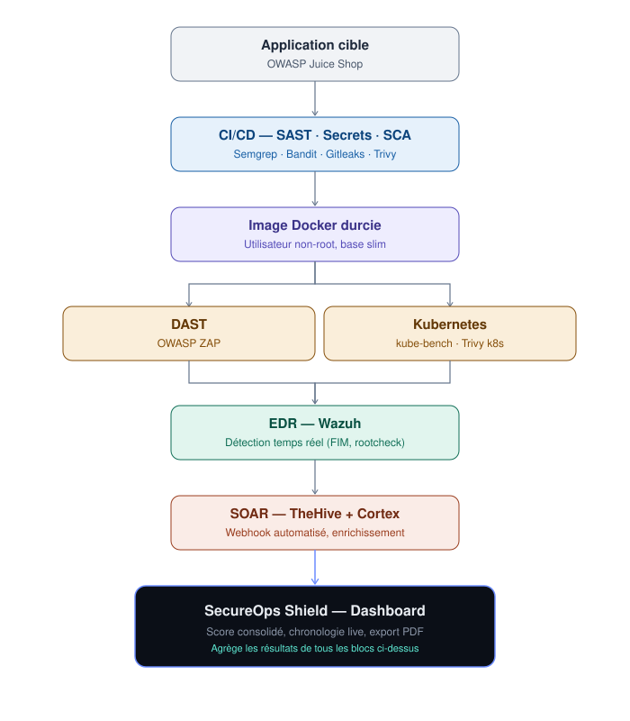

# SecureOps Shield

**Un pipeline DevSecOps complet, de l'analyse du code source jusqu'à la réponse automatisée à incident, avec un tableau de bord qui note la posture de sécurité sur 100.**

> Projet personnel, réalisé de bout en bout par mes soins (hors cadre scolaire).
> Il m'a servi à mettre en pratique, sur un cas concret, trois briques que l'on retrouve dans les équipes sécurité modernes : **CI/CD sécurisé**, **EDR** (détection sur les machines) et **SOAR** (réponse à incident automatisée).

**Liens rapides :**
[Démo vidéo (environ 5 min)](https://drive.google.com/file/d/1jDqAU7jeTyRt1J4_x0iDOBfEYZnnmCnG/view?usp=sharing) ·
[Schéma d'architecture](docs/architecture.svg) ·
[Procédure d'installation](SETUP.md) ·
[Portfolio](https://penelopeeckhar.github.io/portfolio)

[](docs/architecture.svg)

*Schéma d'architecture : cliquer pour l'ouvrir en grand.*

---

## Sommaire

1. [En bref](#en-bref)
2. [Ce que le projet démontre](#ce-que-le-projet-démontre)
3. [Architecture](#architecture)
4. [Détail des 9 blocs](#détail-des-9-blocs)
5. [Résultats chiffrés](#résultats-chiffrés)
6. [Le dashboard et le score de sécurité](#le-dashboard-et-le-score-de-sécurité)
7. [Démo vidéo](#démo-vidéo)
8. [Structure du dépôt](#structure-du-dépôt)
9. [Reproduire le projet](#reproduire-le-projet)
10. [Limites et pistes d'amélioration](#limites-et-pistes-damélioration)
11. [Sécurité du dépôt](#sécurité-du-dépôt)
12. [Auteure](#auteure)

---

## En bref

**Le problème.** Dans une entreprise, la sécurité d'une application ne se joue pas à un seul endroit. Il faut vérifier le code avant qu'il soit déployé, durcir le conteneur qui l'exécute, tester l'application en fonctionnement, sécuriser la plateforme qui l'héberge, surveiller les machines, puis traiter les alertes sans y passer des heures à la main.

**Ma réponse.** J'ai construit cette chaîne complète sur une application cible volontairement vulnérable, **OWASP Juice Shop**, et j'ai relié chaque étape à la suivante :

1. **Avant le déploiement** : à chaque commit, GitHub Actions analyse le code (SAST), cherche des secrets oubliés et audite les dépendances (SCA).
2. **Au build** : l'image Docker est réduite et durcie, puis rescannée pour mesurer le gain.
3. **En fonctionnement** : OWASP ZAP attaque l'application (DAST), y compris avec un utilisateur authentifié.
4. **Sur la plateforme** : l'application tourne dans un cluster Kubernetes (k3s) audité selon le benchmark CIS.
5. **Pendant l'exploitation** : Wazuh surveille les machines et détecte les modifications suspectes de fichiers.
6. **À l'alerte** : un script envoie automatiquement l'alerte Wazuh dans TheHive, qui ouvre un dossier d'incident et peut lancer des analyses Cortex.
7. **Pour le pilotage** : un dashboard rassemble tous les résultats en un score unique et génère un rapport PDF.

Tout fonctionne en local, sur une machine virtuelle Debian 13, avec des outils open source.

---

## Ce que le projet démontre

| Compétence | Où la voir dans le projet |
|---|---|
| Intégrer la sécurité dans un pipeline CI/CD (SAST, détection de secrets, SCA) | Bloc 2, `.github/workflows/security-pipeline.yml` |
| Durcir une image Docker et mesurer le résultat | Bloc 3, trois Dockerfiles comparés avec Trivy |
| Tester une application web de façon dynamique, y compris authentifiée | Bloc 4, OWASP ZAP (baseline, full scan, authentifié) |
| Sécuriser un déploiement Kubernetes et auditer un cluster (CIS) | Bloc 5, `k8s/` |
| Déployer et configurer un EDR / SIEM (surveillance d'intégrité des fichiers) | Bloc 6, Wazuh |
| Automatiser la réponse à incident (SOAR) | Bloc 7, Wazuh vers TheHive et Cortex |
| Développer une API et une interface de supervision | Bloc 8, Flask, nginx, HTML/CSS/JS |
| Produire un reporting exploitable par un décideur | Bloc 8, export PDF (WeasyPrint) |
| Documenter et rendre un travail reproductible | `SETUP.md`, diagramme d'architecture |

---

## Architecture

Le flux de données suit le cycle de vie de l'application :

```
Code source ──► CI/CD (SAST · Secrets · SCA)
                   │
                   ▼
            Image Docker durcie ──► DAST (OWASP ZAP)
                   │
                   ▼
            Kubernetes (k3s) ──► Audit CIS (kube-bench) + Trivy k8s
                   │
                   ▼
            EDR Wazuh (FIM temps réel)
                   │  alerte niveau 7 ou plus
                   ▼
            SOAR : TheHive (dossiers) + Cortex (analyses)
                   │
                   ▼
            Dashboard : score global, chronologie live, rapport PDF
```

**Environnement de lab** : VM Debian 13 (XFCE) ; Docker et Docker Compose pour presque tous les services ; k3s pour Kubernetes.

**Ports utilisés** : Juice Shop `3000`, TheHive `9000`, Cortex `9001`, API du dashboard `5000`, interface du dashboard `8090`.

---

## Détail des 9 blocs

### Bloc 0 : Environnement
Une VM Debian 13 avec Docker. Le fichier `docker-compose.yml` à la racine lance l'application cible.

### Bloc 1 : Application cible vulnérable
**OWASP Juice Shop** est une application web (Node.js) conçue pour contenir des failles réalistes (injections, authentification cassée, mauvaise configuration, etc.). C'est un terrain d'entraînement légal : elle permet de tester des outils de sécurité sans toucher à un vrai système.

### Bloc 2 : CI/CD sécurisé (SAST, secrets, SCA)
Le workflow GitHub Actions `security-pipeline.yml` se déclenche à chaque `push` et `pull request` sur `main`, avec trois contrôles en parallèle :

| Contrôle | Outil | Ce qu'il cherche |
|---|---|---|
| **SAST** (analyse statique du code) | Semgrep, règles JavaScript | Failles dans le code source (injections, usages dangereux) |
| **Secrets** | Gitleaks | Clés d'API, mots de passe ou jetons commités par erreur, y compris dans l'historique Git |
| **SCA** (dépendances) | Trivy en mode système de fichiers | Bibliothèques vulnérables, en sévérités CRITICAL, HIGH et MEDIUM ; le rapport est conservé comme artefact du workflow |

Sur le code de Juice Shop, l'analyse des dépendances a remonté **81 vulnérabilités, dont 8 critiques**.

### Bloc 3 : Conteneurisation et durcissement de l'image
Une image Docker embarque souvent bien plus que nécessaire (compilateurs, outils, système complet), ce qui multiplie la surface d'attaque. J'ai donc comparé la même application à plusieurs étapes de durcissement :

| Étape | Fichier | Principe |
|---|---|---|
| Non durcie (référence) | `Dockerfile.unhardened` | Image de base complète (`node:22-slim`), tout est conservé, exécution en root |
| Durcie, étapes intermédiaires | rapports `trivy-hardened*.json` | Premières itérations : build en plusieurs étapes, dépendances de développement supprimées, utilisateur non-root |
| Distroless (version finale) | `Dockerfile` (identique à `Dockerfile.distroless`) et `docker/juice-shop/Dockerfile.hardened` | Build multi-étapes, puis image finale **distroless** de Google : sans shell ni gestionnaire de paquets, avec uniquement le runtime Node.js. Fichiers inutiles retirés (tests, documentation, scripts d'infrastructure, fichiers de CI). Exécution sous un utilisateur non privilégié (UID 65532) |

Chaque version a été scannée avec Trivy ; les rapports sont versionnés (`trivy-*.json` et `trivy-image-report-*.txt`). Voir les chiffres dans [Résultats chiffrés](#résultats-chiffrés).

### Bloc 4 : Tests dynamiques (DAST) avec OWASP ZAP
Contrairement à l'analyse du code, le DAST attaque l'application **en cours d'exécution**, comme le ferait un pirate. J'ai réalisé trois campagnes complémentaires :

- **Baseline** : scan passif rapide.
- **Full scan** : exploration et attaque actives.
- **Authentifié** : ZAP se connecte avec un compte utilisateur (jeton injecté via un plan d'automatisation) pour atteindre les pages réservées aux utilisateurs connectés, que les scans anonymes ne voient jamais.

Les rapports HTML, JSON et Markdown sont dans `zap-reports/`.

### Bloc 5 : Sécurité Kubernetes
L'application est déployée sur **k3s** (Kubernetes léger) avec un manifeste durci (`k8s/juiceshop-deployment.yaml`) :

- exécution en non-root (`runAsNonRoot`, UID 65532) ;
- pas d'élévation de privilèges (`allowPrivilegeEscalation: false`) ;
- système de fichiers racine en lecture seule (`readOnlyRootFilesystem: true`), avec des volumes temporaires explicites pour les seuls dossiers qui doivent être modifiables ;
- toutes les capacités Linux retirées (`drop: ALL`) ;
- profil seccomp par défaut (`RuntimeDefault`) ;
- demandes et limites de CPU et de mémoire.

Deux audits complètent ce déploiement :

- **kube-bench** : vérifie le cluster selon le **CIS Kubernetes Benchmark** (référence de bonnes pratiques).
- **Trivy Kubernetes** : détecte vulnérabilités et mauvaises configurations dans les charges de travail et les composants du cluster (CoreDNS, metrics-server, etc.).

### Bloc 6 : Détection sur les machines (EDR) avec Wazuh
Wazuh (v4.9.2, déployé via `wazuh-docker`) surveille les machines. Sa fonction centrale ici est le **FIM** (*File Integrity Monitoring*) : il repère les fichiers modifiés, créés ou supprimés.

- Surveillance **en temps réel** de `/etc`, `/usr/bin` et `/usr/sbin`, les répertoires les plus sensibles d'un système Linux.
- Surveillance périodique de `/bin`, `/sbin` et `/boot`.
- Détection de rootkits (*rootcheck*).

La configuration modifiée est dans `wazuh-config/wazuh_manager.conf.example` (version sans secret).

### Bloc 7 : Réponse à incident automatisée (SOAR)
C'est le bloc qui évite de traiter les alertes une par une à la main.

- **TheHive 5.2** gère les alertes et les dossiers d'incident ; **Cortex 3.1.7** exécute des analyseurs sur les éléments suspects (adresses IP, etc.). Ils tournent avec Cassandra et Elasticsearch (`thehive-cortex/docker-compose.yml`).
- Un **script d'intégration personnalisé** (`wazuh-thehive-integration/custom-w2thive.py`) est appelé par Wazuh pour toute alerte de **niveau 7 ou plus**. Il la convertit au format TheHive et crée l'alerte via l'API :
  - niveau 12 ou plus, sévérité haute ;
  - niveau 7 à 11, sévérité moyenne ;
  - en dessous, sévérité basse ;
  - l'alerte reçoit des étiquettes (nom de l'agent, identifiant de la règle) pour faciliter le tri.

**Scénario testé de bout en bout :** je modifie un fichier dans `/etc` ; Wazuh détecte le changement en temps réel et lève une alerte de niveau 7 (« Integrity checksum changed », règle 550) ; le script la transmet ; l'alerte apparaît automatiquement dans TheHive, sans aucune action manuelle. Côté Cortex, j'ai également validé l'enrichissement d'une adresse IP avec l'analyseur Tor (job terminé avec succès).

### Bloc 8 : Dashboard centralisé et score de sécurité
Une API Flask lit les résultats de tous les outils et les présente dans une interface web unique. Détails dans la section suivante.

---

## Résultats chiffrés

### Réduction de la surface d'attaque de l'image Docker (Trivy, sévérités HIGH et CRITICAL)

| Image | Vulnérabilités | dont CRITICAL | dont HIGH |
|---|---:|---:|---:|
| Non durcie (référence) | **350** | 16 | 334 |
| Durcie, itérations intermédiaires (v1 et v2) | 84 | 14 | 70 |
| Durcie, itération intermédiaire (v3) | 75 | 14 | 61 |
| **Distroless** | **51** | 9 | 42 |

Le durcissement divise le nombre de vulnérabilités par près de **7** (350 vers 51) et réduit aussi la taille de l'image, de 3,99 Go à 497 Mo.
À titre de comparaison, l'image officielle publiée par les mainteneurs de Juice Shop en compte 48 : l'image distroless obtenue se situe au même niveau.

### Audit Kubernetes (kube-bench, CIS)
- 14 contrôles réussis et 2 échecs sur les contrôles automatisés, soit **88 % de conformité** ;
- 32 avertissements, qui correspondent à des contrôles manuels à vérifier (par exemple l'usage de l'espace de noms `default`).

### Tests dynamiques (OWASP ZAP)

| Campagne | Types d'alertes | Niveaux relevés |
|---|---:|---|
| Baseline | 10 | 2 moyennes, 5 faibles, 3 informatives |
| Full scan | 12 | 3 moyennes, 5 faibles, 4 informatives |
| Authentifié (v2) | 13 | 1 haute, 5 moyennes, 4 faibles, 3 informatives |

Le scan authentifié est le seul à faire apparaître une alerte de niveau **haut** : c'est l'illustration concrète de l'intérêt de tester avec un compte connecté.

### Réponse à incident
Chaîne Wazuh vers TheHive opérationnelle de bout en bout (alerte créée automatiquement, sans intervention humaine).

---

## Le dashboard et le score de sécurité

**Interface** (`dashboard/`, servie par nginx sur le port 8090) :
- jauge « bouclier » dynamique à quatre anneaux (image, DAST, Kubernetes, score global), colorés et remplis selon les vraies valeurs ;
- chronologie des **8 derniers incidents**, lue en direct dans TheHive ;
- détail par catégorie (répartition par sévérité) ;
- bouton d'**export PDF**.

**API** (`dashboard/api/app.py`, Flask derrière Gunicorn) :
- `GET /api/summary` : scores et chiffres clés ;
- `GET /api/report` : rapport PDF complet ;
- `GET /api/health` : état du service.

**Rapport PDF** (WeasyPrint) : page de couverture avec le score global, résumé par catégorie, détail par sévérité, chronologie des incidents et méthodologie de calcul.

### Comment le score est calculé
Chaque catégorie reçoit une note de 0 à 100, puis une moyenne pondérée donne le score global. Le calcul est volontairement simple et documenté dans `dashboard/api/report.py` et `dashboard/api/app.py`.

| Catégorie | Poids | Calcul de la note |
|---|---:|---|
| Image Docker (Trivy) | 40 % | 100 moins (4 par CRITICAL, 0,3 par HIGH, 0,1 par MEDIUM), minimum 0 |
| DAST (ZAP) | 30 % | 100 moins (8 par High, 1 par Medium, 0,2 par Low, en comptant chaque occurrence), minimum 0 |
| Kubernetes (CIS) | 30 % | Pourcentage de conformité kube-bench |

Chaque catégorie est plafonnée séparément, de sorte qu'une seule catégorie très mauvaise ne fasse pas tomber le score global à zéro. Si une source est indisponible, les poids restants sont renormalisés.

> Ces coefficients sont une **heuristique** que j'ai choisie et documentée, pas un standard de l'industrie. Le but est d'obtenir un indicateur lisible qui évolue dans le bon sens quand on corrige des problèmes.

**Exemple sur le lab** : score de **53/100** (image : 75 vulnérabilités dont 14 critiques ; DAST : 80 occurrences ; Kubernetes : 88 % ; TheHive : 1 dossier pour 13 alertes). Ce score modeste est cohérent : la cible est une application construite pour être vulnérable.

---

## Démo vidéo

Une démonstration d'environ 5 minutes présente le projet de bout en bout : architecture Docker, Juice Shop, pipeline CI/CD, durcissement de l'image, scan DAST, audit Kubernetes, scénario SOAR en direct (Wazuh vers TheHive), puis dashboard et export PDF.

[Voir la démo sur Google Drive](https://drive.google.com/file/d/1jDqAU7jeTyRt1J4_x0iDOBfEYZnnmCnG/view?usp=sharing)

---

## Structure du dépôt

```
secureops-shield/
├── .github/workflows/
│   └── security-pipeline.yml          # Bloc 2 : SAST, secrets, SCA
├── Dockerfile                          # Bloc 3 : image finale (distroless)
├── Dockerfile.distroless               # Bloc 3 : identique, nom explicite
├── Dockerfile.unhardened               # Bloc 3 : référence non durcie
├── docker/juice-shop/Dockerfile.hardened
├── docker-compose.yml                  # Bloc 0 : application cible
├── trivy-*.json / trivy-image-report-*.txt   # Bloc 3 : rapports de scan d'image
├── zap-reports/                        # Bloc 4 : rapports et plans ZAP
├── k8s/                                # Bloc 5 : manifeste, kube-bench, Trivy k8s
├── wazuh-config/                       # Bloc 6 : configuration Wazuh (sans secret)
├── wazuh-thehive-integration/          # Bloc 7 : script custom-w2thive.py
├── thehive-cortex/                     # Bloc 7 : TheHive, Cortex, Cassandra, Elasticsearch
├── dashboard/                          # Bloc 8 : API Flask, interface, export PDF
├── docs/architecture.svg               # Schéma d'architecture
└── SETUP.md                            # Procédure de reconstitution
```

Les projets tiers (code de Juice Shop, stack Wazuh officielle) ne sont **pas** copiés dans le dépôt : seuls les fichiers que j'ai écrits ou modifiés y figurent.

---

## Reproduire le projet

Prérequis : une machine Linux (j'ai utilisé Debian 13), Docker avec Docker Compose, Git, et k3s pour la partie Kubernetes.

```bash
# 1. Application cible : cloner Juice Shop et utiliser le Dockerfile durci
git clone https://github.com/juice-shop/juice-shop.git juice-shop-src
cp docker/juice-shop/Dockerfile.hardened juice-shop-src/Dockerfile

# 2. Stack Wazuh officielle, avec ma configuration
git clone https://github.com/wazuh/wazuh-docker.git -b v4.9.2 wazuh-docker
cp wazuh-config/wazuh_manager.conf.example \
   wazuh-docker/single-node/config/wazuh_cluster/wazuh_manager.conf
# Éditer ce fichier : remplacer YOUR_THEHIVE_API_KEY_HERE par la clé API TheHive

# 3. Secrets : créer dashboard/.env
echo "THEHIVE_API_KEY=<clé générée dans TheHive>" > dashboard/.env
```

Lancer ensuite les stacks dans l'ordre **Bloc 0, 1, 6, 7, 8** avec le `docker-compose.yml` de chaque dossier (`thehive-cortex/`, `wazuh-docker/single-node/`, `dashboard/`). La procédure complète est dans [`SETUP.md`](./SETUP.md).

Pour refaire la comparaison des images :

```bash
docker build -f Dockerfile.unhardened -t secureops-shield/juice-shop:unhardened .
docker build -f Dockerfile.distroless -t secureops-shield/juice-shop:distroless .
trivy image --severity HIGH,CRITICAL secureops-shield/juice-shop:unhardened
trivy image --severity HIGH,CRITICAL secureops-shield/juice-shop:distroless
```

---

## Limites et pistes d'amélioration

Par honnêteté sur la portée du projet :

- **Environnement de lab** : tout tourne sur une seule VM, avec une seule instance de chaque service. Ce n'est pas une architecture de production (pas de haute disponibilité, pas de TLS partout).
- **Cible volontairement vulnérable** : les chiffres montrent l'efficacité des outils et du durcissement, pas la sécurité d'une application réelle.
- **Score heuristique** : les coefficients du score sont des choix arbitraires, documentés mais non validés par un standard.
- **Semgrep en mode non bloquant** : l'étape SAST ne fait pas échouer le workflow (`continue-on-error`). En production, on placerait un seuil de blocage sur les sévérités critiques.
- **Dashboard sur rapports fichiers** : l'API lit des rapports exportés (Trivy, ZAP, kube-bench) plutôt que d'interroger les outils en direct ; seul TheHive est interrogé en temps réel.

Pistes à explorer :
- ajouter Bandit ou CodeQL pour compléter l'analyse statique ;
- bloquer le déploiement quand le score ou les vulnérabilités critiques dépassent un seuil (*quality gate*) ;
- étendre la détection Wazuh avec des règles personnalisées et des *active responses* (blocage automatique) ;
- ajouter des *playbooks* Cortex pour enrichir automatiquement chaque alerte ;
- déployer sur un vrai cluster avec politiques réseau et gestion des secrets (Vault, Sealed Secrets).

---

## Sécurité du dépôt

Les clés API de l'application (par exemple celle de TheHive) sont lues dans des variables d'environnement, via un fichier `.env` non commité (voir `.gitignore`). Les configurations publiées utilisent des valeurs de remplacement (`YOUR_THEHIVE_API_KEY_HERE`). Les outils tiers sont clonés séparément, comme décrit dans `SETUP.md`.

Juice Shop est **volontairement vulnérable** : ne jamais l'exposer sur Internet.

---

## Auteure

**Abir Majdi** : étudiante ingénieure en Génie du Développement Numérique et Cybersécurité (ENSA Fès), orientée cybersécurité défensive.

- GitHub : [penelopeeckhar](https://github.com/penelopeeckhar)
- Portfolio : [penelopeeckhar.github.io/portfolio](https://penelopeeckhar.github.io/portfolio)
